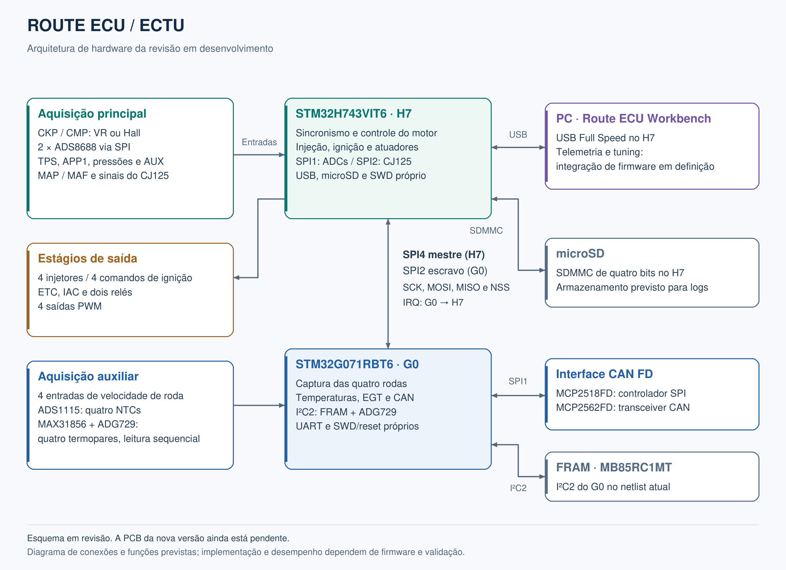
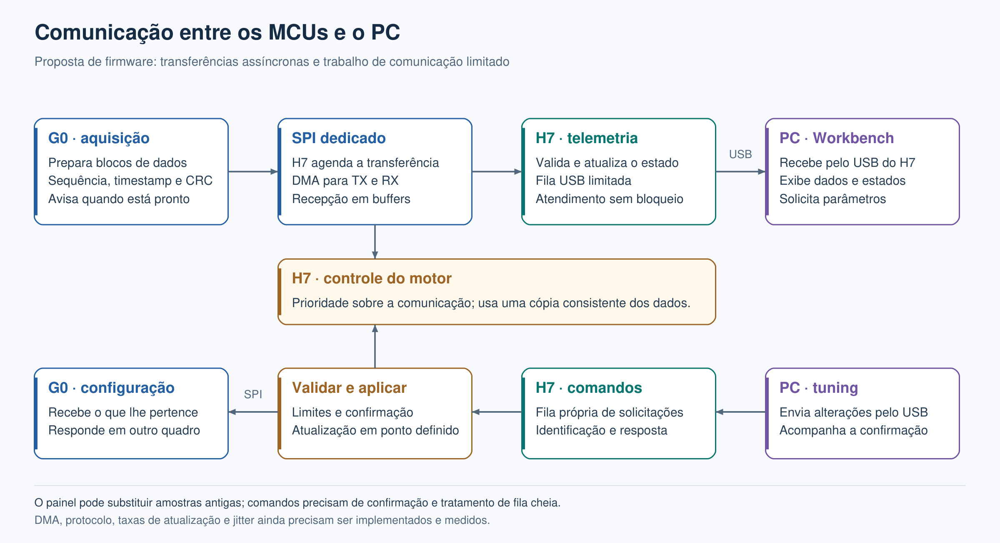
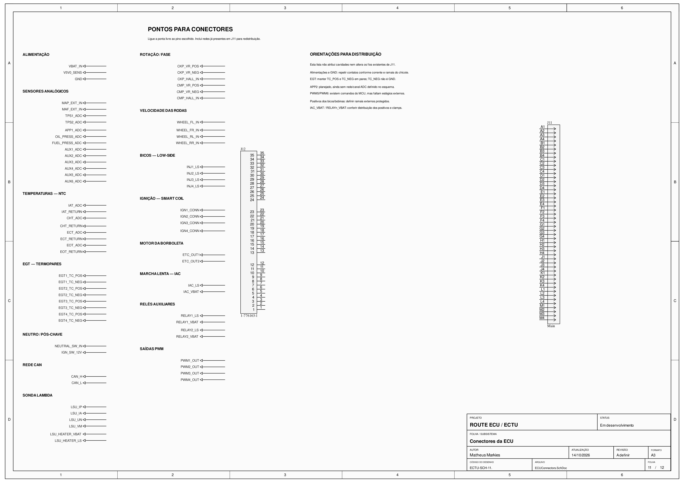
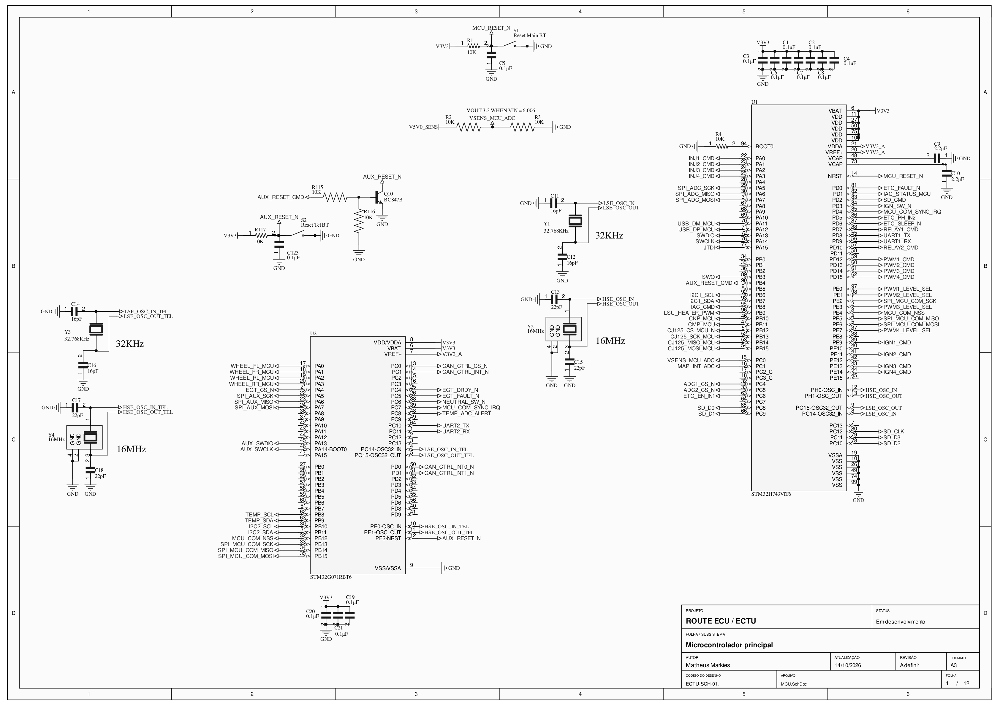
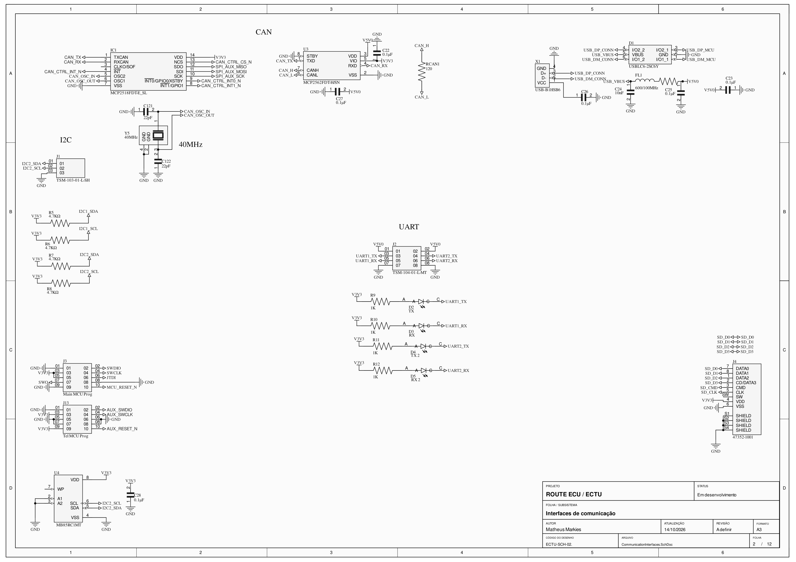
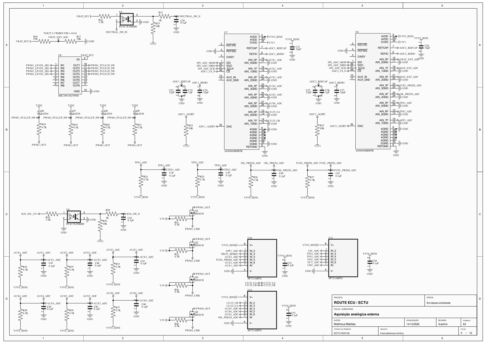
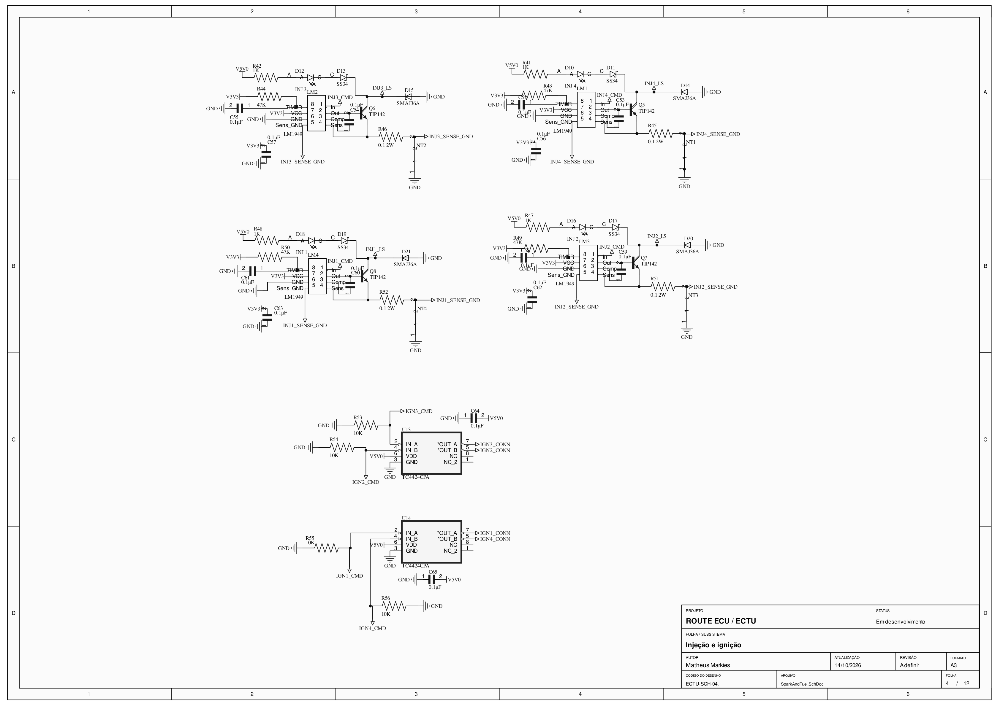
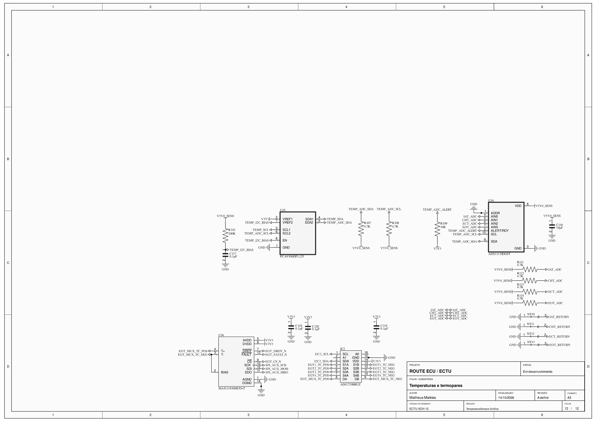

# Route ECU — Hardware

Projeto de uma unidade de controle eletrônico para motores de combustão interna, com quatro canais de injeção, quatro comandos de ignição e aquisição de sensores distribuída entre dois microcontroladores STM32.

**Status: em desenvolvimento. O esquemático está em revisão, a PCB da nova versão ainda está pendente e a pinagem dos dois conectores externos está em aberto.**



## Repositórios do projeto

| Repositório | Conteúdo |
|---|---|
| [Route ECU Hardware](https://github.com/MatheusMarkies/Route-ECU-Hardware) | Esquemáticos, projeto Altium e documentação do hardware. |
| [Route ECU Firmware](https://github.com/MatheusMarkies/Route-ECU-Firmware) | Firmware embarcado da ECU. |
| [Route ECU Workbench](https://github.com/MatheusMarkies/Route-ECU-Workbench) | Software de telemetria, configuração e tuning. |

Os três repositórios fazem parte do mesmo projeto. A compatibilidade entre uma revisão de hardware, uma versão do firmware e uma versão do Workbench deve ser verificada durante a integração.

## O que esta revisão prevê

| Bloco | Organização no esquema |
|---|---|
| Processamento principal | STM32H743VIT6, responsável pelo sincronismo do motor, controle e interface USB. |
| Processamento auxiliar | STM32G071RBT6, com aquisição das rodas, temperaturas, EGT e interface CAN. |
| Comunicação entre MCUs | SPI dedicado, com H7 como mestre, G0 como escravo, chip select e linha de aviso. |
| Injeção | Quatro canais low-side com LM1949 e TIP142, em arquitetura peak-and-hold. |
| Ignição | Quatro saídas de comando por TC4424 para bobinas com ignitor integrado, conforme a folha de conectores. |
| Rotação e fase | Entradas CKP/CMP para sensores VR ou Hall; condicionamento VR por MAX9924. |
| Aquisição analógica | Dois ADS8688 de oito canais, ligados ao H7 por SPI. |
| Temperaturas NTC | Quatro entradas: IAT, CHT, ECT e EOT, lidas por um ADS1115. |
| Temperaturas EGT | Quatro pares de termopares selecionados por ADG729 e lidos sequencialmente por um MAX31856. |
| Lambda wideband | Circuito baseado no CJ125, com interface SPI, sinais analógicos UA/UR e comando do aquecedor. |
| Borboleta eletrônica | Ponte H com DRV8873H, com comandos e sinal de falha para o H7. |
| Atuadores auxiliares | IAC, dois comandos de relés low-side e quatro saídas PWM. |
| CAN FD | Controlador MCP2518FD no SPI do G0 e transceiver MCP2562FD. |
| Comunicação com o PC | USB Full Speed no H7, destinado à telemetria e ao tuning pelo Workbench. |
| Armazenamento | FRAM MB85RC1MT por I²C e microSD por SDMMC de quatro bits. |
| Alimentação | Entrada nominal de projeto de 12 V, reguladores de 5 V e 3,3 V e alimentação filtrada de sensores. |
| Programação e recuperação | Interfaces de programação e redes de reset separadas para H7 e G0; comando do reset do G0 pelo H7. |

Esses itens descrevem os blocos presentes ou previstos no esquemático. Quantidade de canais e resolução nominal dos componentes não representam desempenho, precisão ou capacidade de corrente já medidos. Faixa de alimentação, consumo, temporização e comportamento térmico ainda dependem da validação da revisão completa.

## Escolhas de projeto e justificativas

### Dois MCUs com responsabilidades definidas

O H7 concentra as tarefas que dependem do sincronismo do motor: captura de CKP/CMP, agendamento de injeção e ignição e controle dos atuadores. O G0 concentra aquisição e interfaces auxiliares, incluindo quatro rodas, temperaturas, EGT e CAN. Essa divisão distribui periféricos e rotinas de atendimento, preservando a prioridade do controle principal.

A divisão exige que cada dado recebido tenha validade e tempo de atualização conhecidos. O H7 precisa identificar dados vencidos ou perda de comunicação com o G0 e executar o tratamento previsto para cada função.

### SPI dedicado entre H7 e G0

O enlace usa um periférico próprio em cada MCU, separado do SPI dos ADCs e do SPI auxiliar de CAN/EGT. O H7, como mestre, controla o início e o tamanho das transferências. A linha `MCU_COM_SYNC_IRQ` permite que o G0 avise quando há dados preparados.

O uso de DMA, buffers alternados e transferências em blocos é a estratégia proposta para reduzir o trabalho de movimentação de dados pela CPU. A alocação dos canais de DMA, o protocolo e os limites de tempo ainda precisam ser definidos e testados no firmware.

### USB no H7 e uma conexão para o Workbench

O USB do H7 será a interface do programa com a ECU. Dados produzidos pelo G0 chegam ao H7 pelo SPI e são encaminhados ao Workbench junto aos dados do controle principal. Comandos destinados ao G0 percorrem o caminho inverso.

O atendimento ao PC deve usar filas limitadas e operações sem espera bloqueante. Uma pausa do programa ou a desconexão do cabo não deve fazer o controle do motor esperar pela comunicação. Telemetria de painel pode priorizar o estado mais recente; comandos de tuning precisam de identificação, validação e confirmação.



*Fluxo proposto para o firmware. DMA, prioridades, taxas de atualização e latências ainda não foram validados nesta documentação.*

### ADCs externos para funções diferentes

Os dois ADS8688 concentram 16 canais de aquisição analógica, incluindo sensores externos, monitoramento de alimentação e sinais do CJ125. O ADS1115 atende às quatro temperaturas NTC. Essa organização distribui os canais sem exigir um pino ADC interno do MCU para cada sensor e permite tratar separadamente as taxas de aquisição das diferentes grandezas.

O condicionamento continua sendo parte do hardware: divisores, filtros, proteção e resistores de polarização dependem do sensor. A configuração de faixa do ADC não substitui esses circuitos. APP2 permanece planejado e ainda não possui rede/canal definido nesta revisão.

### CAN FD no auxiliar mantendo o G071

O STM32G071RBT6 escolhido para o auxiliar não possui controlador CAN integrado. O MCP2518FD fornece essa função por SPI, enquanto o MCP2562FD faz a interface elétrica com o barramento. Assim, o CAN fica sob responsabilidade do G0 mantendo o MCU previsto no projeto.

O controlador CAN e o MAX31856 compartilham o SPI auxiliar com chip selects independentes. O firmware deve arbitrar as transações e respeitar os modos e limites de cada componente.

### Quatro termopares com um conversor

O ADG729 seleciona o par de termopar que será lido pelo MAX31856. Isso permite atender quatro posições de EGT com um único conversor, aceitando uma leitura sequencial. O tempo de acomodação após a troca de canal, a conversão e a atualização de cada temperatura precisam entrar no dimensionamento do firmware.

Os negativos dos termopares permanecem como `TC_NEG`; eles não devem ser tratados como retornos de GND na distribuição dos conectores.

### Estágios específicos para os atuadores

Os injetores utilizam controle de corrente por LM1949 com estágio de potência TIP142. As saídas de ignição desta revisão são comandos para smart coils, e o motor da borboleta usa uma ponte H dedicada. Cada tipo de carga tem seu próprio estágio de acionamento, em vez de ser tratado como uma saída genérica do MCU.

Correntes de pico e sustentação, dissipação, clamps e comportamento em falha ainda precisam ser verificados com as cargas e a PCB definitivas.

### Reset independente e monitoramento dos 5 V

As redes `MCU_RESET_N` e `AUX_RESET_N` foram separadas. O G0 possui botão próprio e um estágio NPN comandado pelo H7, permitindo solicitar um reset do auxiliar sem acionar o reset externo do MCU principal. Durante a recuperação, os dados do G0 devem ser considerados inválidos até a comunicação ser restabelecida.

A alimentação `V5V0_SENS` possui um divisor para `VSENS_MCU_ADC` no ADC interno do H7. Essa medição ajuda a acompanhar a alimentação dos sensores sem depender apenas dos ADCs externos, que também recebem alimentação dessa rede.

## Conectores externos: dois conectores, pinagem em aberto

**Serão utilizados dois conectores para a interface com o chicote, como indicado em `ECUConnectors.SchDoc`. Os sinais estão organizados na folha, mas ainda não foram distribuídos entre as posições físicas dos conectores.**

| Designador atual | Representação no esquema | Situação |
|---|---|---|
| J11 | Conector identificado como `Main`, com 48 posições representadas. | Distribuição de sinais pendente. |
| J12 | Conector TE `1-776163-1`, com 35 posições representadas. | Distribuição de sinais pendente. |

Os designadores identificam os símbolos atuais. A presença de um sinal na lista abaixo não define um pino, uma posição no conector ou um chicote pronto. A distribuição final deve considerar corrente, contatos de alimentação/retorno, pares de sinais e organização dos ramais.

[](docs/images/schematic-connectors.png)

### Sinais disponibilizados na folha

| Grupo | Redes indicadas para alocação |
|---|---|
| Alimentação | `VBAT_IN`, `V5V0_SENS`, `GND` |
| Sensores analógicos | `MAP_EXT_IN`, `MAF_EXT_IN`, `TPS1_ADC`, `TPS2_ADC`, `APP1_ADC`, `OIL_PRESS_ADC`, `FUEL_PRESS_ADC`, `AUX1_ADC`, `AUX2_ADC`, `AUX3_ADC`, `AUX4_ADC`, `AUX5_ADC`, `AUX6_ADC` |
| Temperaturas NTC | `IAT_ADC`, `IAT_RETURN`, `CHT_ADC`, `CHT_RETURN`, `ECT_ADC`, `ECT_RETURN`, `EOT_ADC`, `EOT_RETURN` |
| Termopares EGT | `EGT1_TC_POS`, `EGT1_TC_NEG`, `EGT2_TC_POS`, `EGT2_TC_NEG`, `EGT3_TC_POS`, `EGT3_TC_NEG`, `EGT4_TC_POS`, `EGT4_TC_NEG` |
| Neutro e pós-chave | `NEUTRAL_SW_IN`, `IGN_SW_12V` |
| CAN | `CAN_H`, `CAN_L` |
| Lambda | `LSU_IP`, `LSU_IA`, `LSU_UN`, `LSU_VM`, `LSU_HEATER_VBAT`, `LSU_HEATER_LS` |
| Rotação e fase | `CKP_VR_POS`, `CKP_VR_NEG`, `CKP_HALL_IN`, `CMP_VR_POS`, `CMP_VR_NEG`, `CMP_HALL_IN` |
| Velocidade das rodas | `WHEEL_FL_IN`, `WHEEL_FR_IN`, `WHEEL_RL_IN`, `WHEEL_RR_IN` |
| Injetores | `INJ1_LS`, `INJ2_LS`, `INJ3_LS`, `INJ4_LS` |
| Comandos de ignição | `IGN1_CONN`, `IGN2_CONN`, `IGN3_CONN`, `IGN4_CONN` |
| Motor da borboleta | `ETC_OUT1`, `ETC_OUT2` |
| Marcha lenta | `IAC_LS`, `IAC_VBAT` |
| Relés auxiliares | `RELAY1_LS`, `RELAY1_VBAT`, `RELAY2_LS`, `RELAY2_VBAT` |
| Saídas PWM | `PWM1_OUT`, `PWM2_OUT`, `PWM3_OUT`, `PWM4_OUT` |

Essa relação reúne os pontos de interface previstos na folha; a continuidade e a associação de todos eles aos respectivos circuitos ainda precisam ser revisadas antes da definição do chicote. APP2 continua como expansão planejada. PWM5/PWM6 aparecem nas anotações de planejamento, mas não são apresentados como saídas externas disponíveis.

USB, microSD e os headers de programação/serviço são interfaces separadas dos dois conectores do chicote. Os sinais de alimentação e os retornos podem exigir mais de um contato; quantidade de redes não equivale a quantidade final de posições ocupadas.

## Prints dos esquemáticos

As imagens abaixo são renderizações das folhas do [PDF do projeto](ECTU.pdf). Clique para abrir em resolução maior. Elas mostram o circuito em desenvolvimento, e não uma placa fabricada ou um resultado de bancada.

| Microcontroladores, clocks e resets | Comunicação, CAN e USB |
|---|---|
| [](docs/images/schematic-mcus.png) | [](docs/images/schematic-communications.png) |

| Aquisição analógica e PWM | Injeção e comandos de ignição |
|---|---|
| [](docs/images/schematic-analog.png) | [](docs/images/schematic-injection-ignition.png) |

| Temperaturas e termopares | Dois conectores com alocação pendente |
|---|---|
| [](docs/images/schematic-temperatures.png) | [](docs/images/schematic-connectors.png) |

O projeto também contém arquivos de PCB e material de revisões anteriores. **A PCB desta nova versão ainda não foi concluída.** Esses arquivos e eventuais vistas antigas no PDF não representam um layout final correspondente ao esquemático atual. Posicionamento, roteamento, integração dos conectores e DRC permanecem pendentes para esta revisão.

## Arquivos e abertura do projeto

O projeto é mantido em **Altium Designer**. Para abrir os arquivos editáveis:

```bash
git clone https://github.com/MatheusMarkies/Route-ECU-Hardware.git
cd Route-ECU-Hardware
```

Abra `ECTU.PrjPcb` no Altium e revise as dependências de bibliotecas. O PDF e as imagens podem ser consultados sem o Altium.

| Arquivo ou pasta | Conteúdo |
|---|---|
| [ECTU.PrjPcb](ECTU.PrjPcb) | Projeto principal do Altium. |
| [ECTU.pdf](ECTU.pdf) | Exportação do projeto; inclui as folhas do esquemático. |
| [MCU.SchDoc](MCU.SchDoc) | H7, G0, clocks, programação e resets. |
| [CommunicationInterfaces.SchDoc](CommunicationInterfaces.SchDoc) | CAN, USB, UART, I²C, FRAM e microSD. |
| [ExternalInterface.SchDoc](ExternalInterface.SchDoc) | ADCs externos, entradas auxiliares e saídas PWM. |
| [SparkAndFuel.SchDoc](SparkAndFuel.SchDoc) | Injeção e comandos de ignição. |
| [CrankAndCam.SchDoc](CrankAndCam.SchDoc) | CKP, CMP e entradas de velocidade das rodas. |
| [TemperatureSensors.SchDoc](TemperatureSensors.SchDoc) | Temperaturas NTC e termopares. |
| [PressureAirflow.SchDoc](PressureAirflow.SchDoc) | Pressão e fluxo de ar. |
| [LambdaWidebandController.SchDoc](LambdaWidebandController.SchDoc) | Controlador lambda e aquecedor. |
| [ETC.SchDoc](ETC.SchDoc) | Acionamento da borboleta eletrônica. |
| [LowSideSwitches.SchDoc](LowSideSwitches.SchDoc) | IAC e relés auxiliares. |
| [PowerManagement.SchDoc](PowerManagement.SchDoc) | Alimentação, reguladores e filtros. |
| [ECUConnectors.SchDoc](ECUConnectors.SchDoc) | Dois conectores e sinais aguardando alocação. |
| [Libraries/](Libraries/) | Bibliotecas locais e documentação dos vínculos. |
| [Templates/](Templates/) | Modelo dos carimbos do projeto. |
| [docs/images/](docs/images/) | Prints, diagramas editáveis e rastreabilidade das imagens. |

Algumas referências de bibliotecas e modelos ainda são herdadas do ambiente de desenvolvimento. A presença das cópias locais não garante que todos os vínculos do Altium estejam resolvidos em outro computador. Consulte as [orientações das bibliotecas](Libraries/LEIA-ME.md) e confira símbolos, footprints e caminhos antes de atualizar o projeto.

## Próximas etapas

- Concluir a revisão elétrica dos blocos, incluindo estados durante inicialização/reset e as ligações dos ADCs.
- Definir a distribuição dos sinais e dos contatos de alimentação/retorno nos dois conectores.
- Desenvolver a PCB da nova versão e revisar posicionamento, roteamento, dissipação e DRC.
- Implementar e integrar os firmwares dos dois MCUs com o Workbench.
- Definir o protocolo SPI, o encaminhamento USB, as filas, os limites de tráfego e a sincronização dos dados.
- Validar aquisição, atuadores, comunicação e temporização em bancada, incluindo carga simultânea de periféricos.
- Registrar a revisão de hardware e as versões de firmware/software utilizadas em cada resultado de teste.

## Contribuições

Sugestões, revisões de circuito e contribuições de documentação são bem-vindas por issues e pull requests. Ao apontar um problema, informe a revisão ou commit, a folha, o designador e a rede envolvidos. Para alterações de circuito, descreva a justificativa e a verificação realizada.

## Autor e licença

Projeto de [Matheus Markies](https://github.com/MatheusMarkies).

A licença do hardware está em definição. Este repositório ainda não contém um arquivo `LICENSE`.
