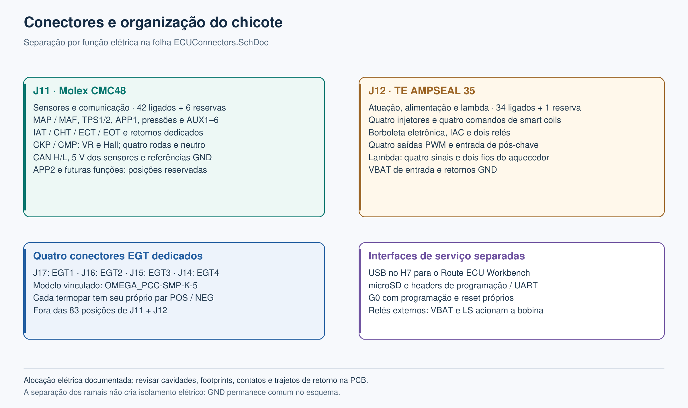
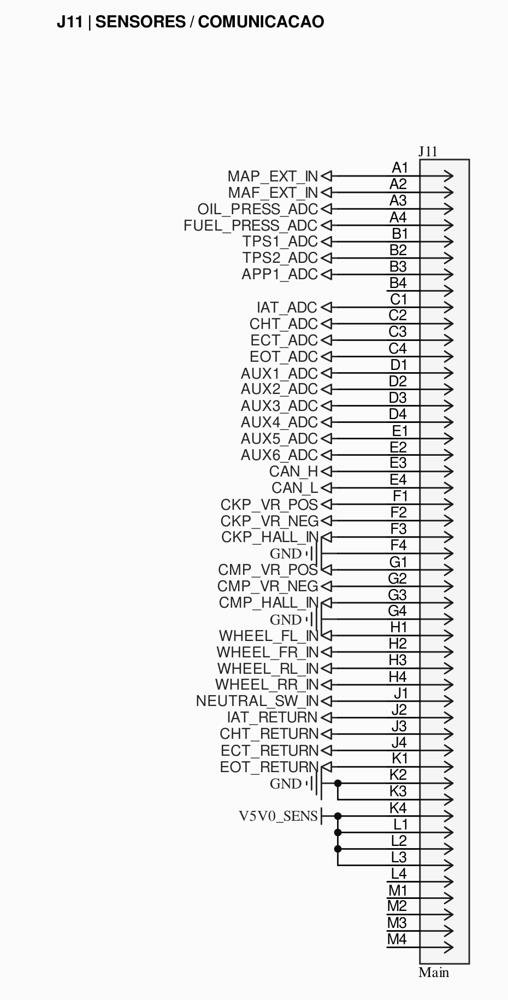
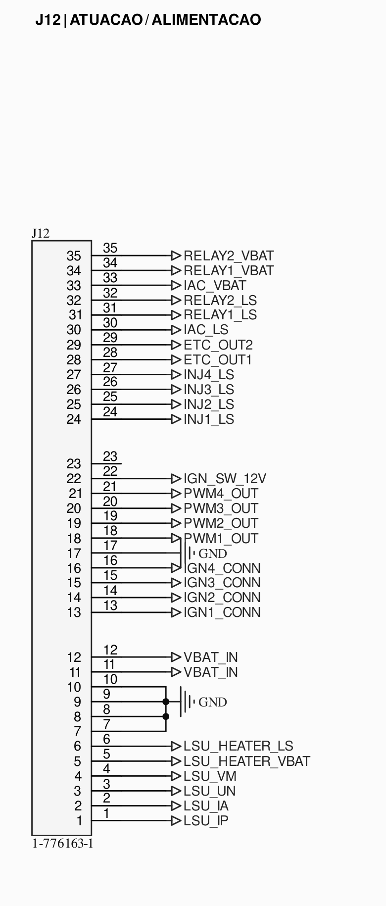
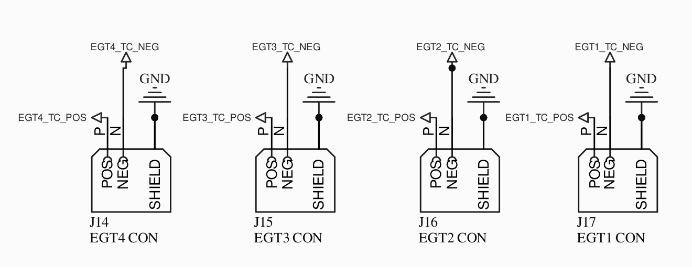
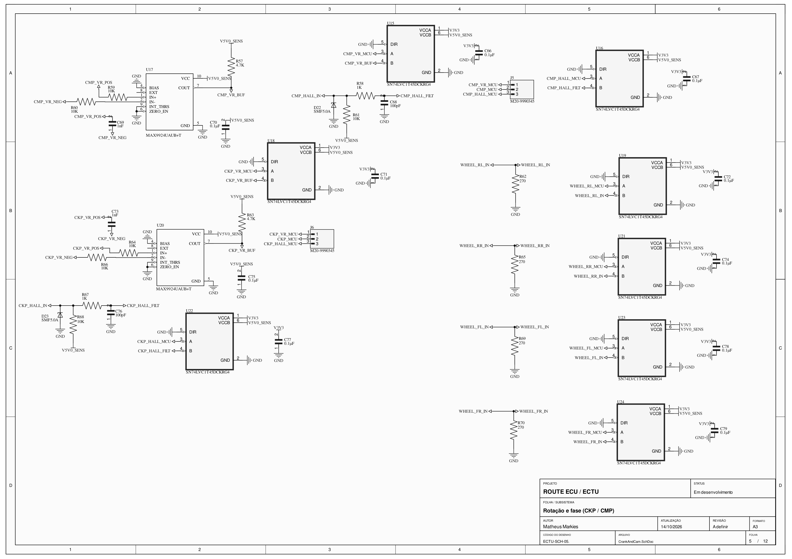
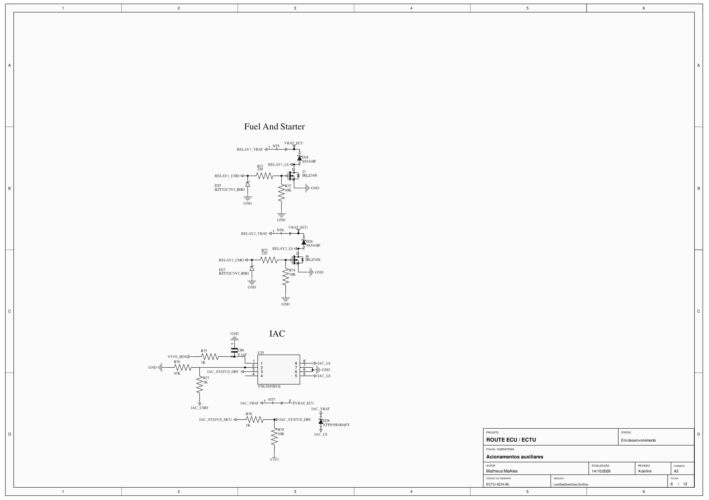
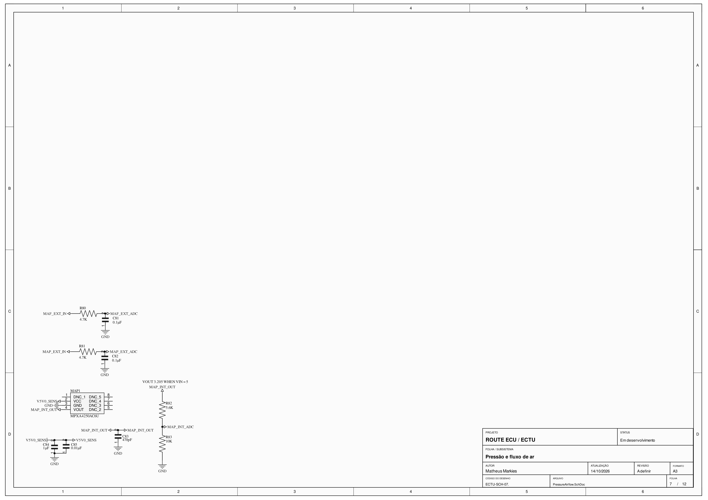
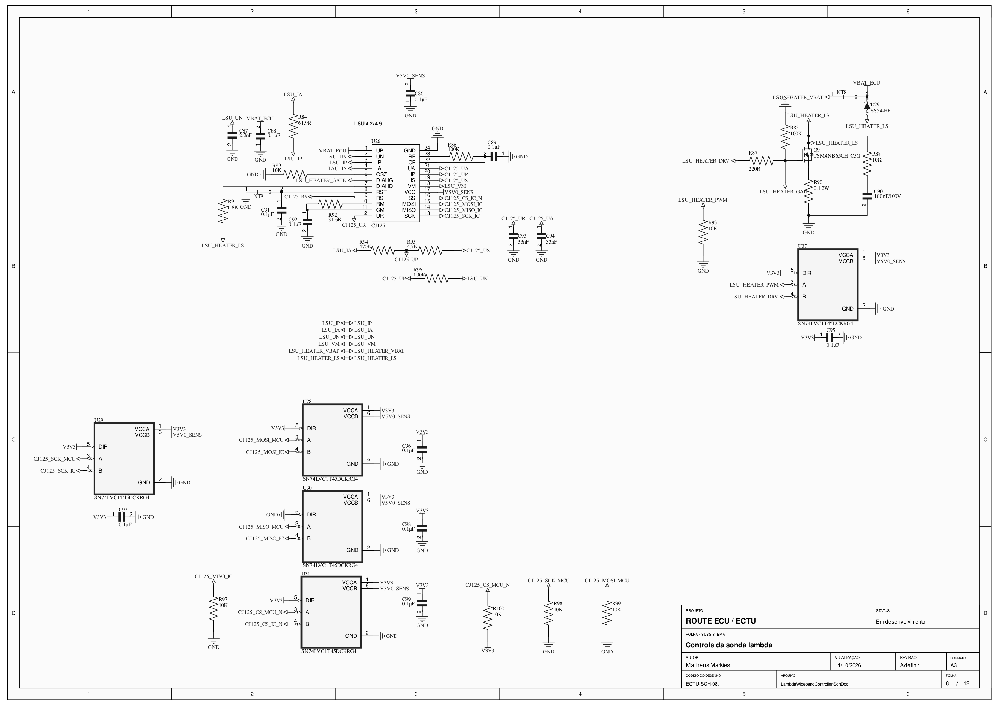
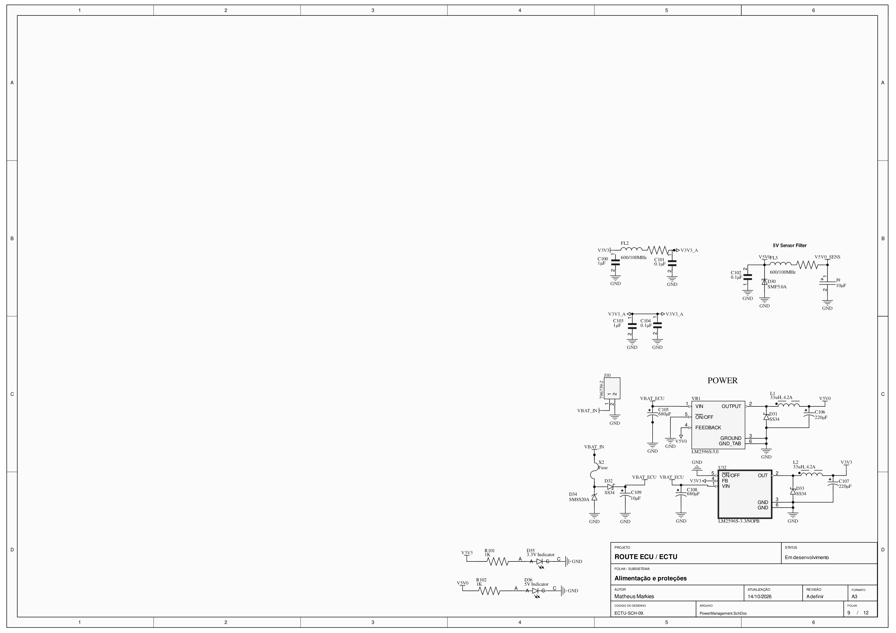
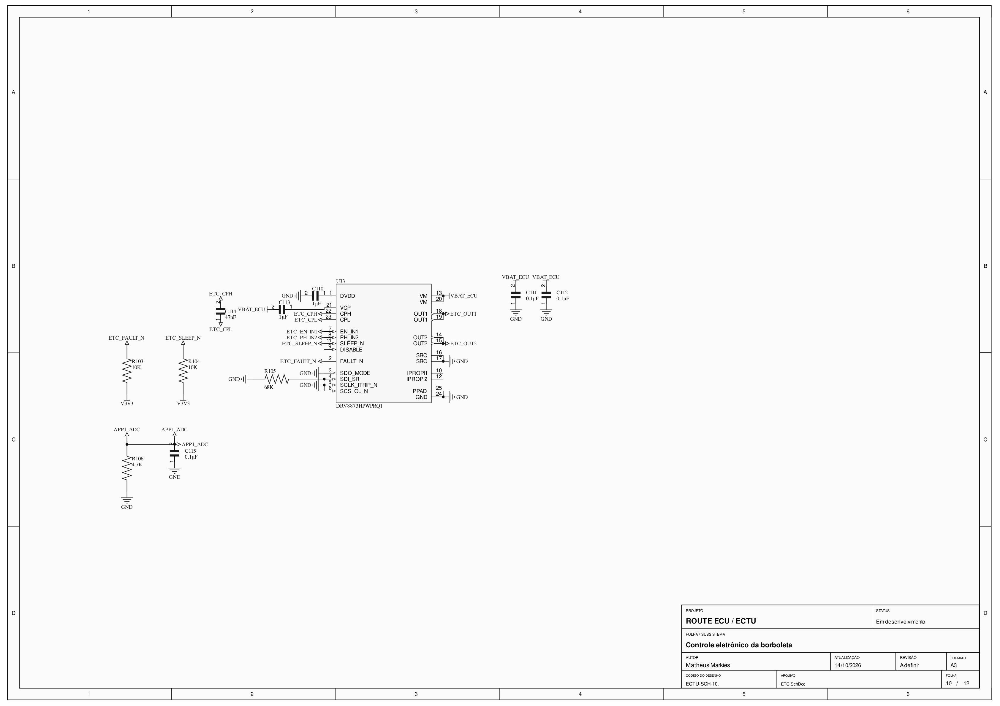

# Route ECU — Hardware

Projeto de uma unidade de controle eletrônico para motores de combustão interna, com quatro canais de injeção, quatro comandos de ignição e aquisição de sensores distribuída entre dois microcontroladores STM32.

**Status: esquemático desta versão concluído e exportado em 31/10/2026. A distribuição elétrica de J11/J12 e os quatro conectores EGT estão no projeto. A PCB da nova versão é a próxima etapa.**

Esta documentação acompanha as 12 folhas do [PDF do projeto](ECTU.pdf) e a [netlist exportada](Project%20Outputs%20for%20ECTU/ECTU.NET). A conclusão do esquemático encerra esta etapa de desenho; a revisão elétrica/ERC, a conferência dos footprints e a validação em bancada seguem no desenvolvimento do hardware.


## Repositórios do projeto

| Repositório | Conteúdo |
|---|---|
| [Route ECU Hardware](https://github.com/MatheusMarkies/Route-ECU-Hardware) | Esquemáticos, projeto Altium e documentação do hardware. |
| [Route ECU Firmware](https://github.com/MatheusMarkies/Route-ECU-Firmware) | Firmware embarcado da ECU. |
| [Route ECU Workbench](https://github.com/MatheusMarkies/Route-ECU-Workbench) | Software de telemetria, configuração e tuning. |

Os três repositórios fazem parte do mesmo projeto. A compatibilidade entre uma revisão de hardware, uma versão do firmware e uma versão do Workbench deve ser verificada durante a integração.

## Hardware desta versão

| Bloco | Organização no esquema |
|---|---|
| Processamento principal | STM32H743VIT6, responsável pelo sincronismo do motor, controle e interface USB. |
| Processamento auxiliar | STM32G071RBT6, com aquisição das rodas, temperaturas, EGT e interface CAN. |
| Comunicação entre MCUs | SPI dedicado, com H7 como mestre, G0 como escravo, chip select e linha de aviso. |
| Injeção | Quatro canais low-side com LM1949 e TIP142, em arquitetura peak-and-hold. |
| Ignição | Quatro saídas de comando por TC4424 para bobinas com ignitor integrado, conforme a folha de conectores. |
| Rotação e fase | Entradas CKP/CMP para sensores VR ou Hall; condicionamento VR por MAX9924. |
| Aquisição analógica | Dois ADS8688 de oito canais, ligados ao H7 por SPI. |
| Temperaturas NTC | Quatro entradas: IAT, CHT, ECT e EOT, lidas por um ADS1115. |
| Temperaturas EGT | Quatro conectores dedicados tipo K, com pares selecionados por ADG729 e lidos sequencialmente por um MAX31856. |
| Lambda wideband | Circuito baseado no CJ125, com interface SPI, sinais analógicos UA/UR e comando do aquecedor. |
| Borboleta eletrônica | Ponte H com DRV8873H, com comandos e sinal de falha para o H7. |
| Atuadores auxiliares | IAC, dois comandos de relés low-side e quatro saídas PWM. |
| CAN FD | Controlador MCP2518FD no SPI do G0 e transceiver MCP2562FD. |
| Comunicação com o PC | USB Full Speed no H7, destinado à telemetria e ao tuning pelo Workbench. |
| Armazenamento | FRAM MB85RC1MT por I²C e microSD por SDMMC de quatro bits. |
| Alimentação | Entrada nominal de projeto de 12 V, reguladores de 5 V e 3,3 V e alimentação filtrada de sensores. |
| Programação e recuperação | Interfaces de programação e redes de reset separadas para H7 e G0; comando do reset do G0 pelo H7. |

Esses itens descrevem os blocos do esquemático. Faixa de alimentação, consumo, precisão, correntes e comportamento térmico serão verificados com a PCB e os ensaios desta revisão.

## Escolhas de projeto e justificativas

### Dois MCUs com responsabilidades definidas

O H7 concentra as tarefas que dependem do sincronismo do motor: captura de CKP/CMP, agendamento de injeção e ignição e controle dos atuadores. O G0 concentra aquisição e interfaces auxiliares, incluindo quatro rodas, temperaturas, EGT e CAN. Essa divisão distribui periféricos e rotinas de atendimento, preservando a prioridade do controle principal.

A divisão exige que cada dado recebido tenha validade e tempo de atualização conhecidos. O H7 precisa identificar dados vencidos ou perda de comunicação com o G0 e executar o tratamento previsto para cada função.

### SPI dedicado entre H7 e G0

O enlace usa um periférico próprio em cada MCU, separado do SPI dos ADCs e do SPI auxiliar de CAN/EGT. O H7, como mestre, controla o início e o tamanho das transferências. A linha `MCU_COM_SYNC_IRQ` permite que o G0 avise quando há dados preparados.

O uso de DMA, buffers alternados e transferências em blocos é a estratégia proposta para reduzir o trabalho de movimentação de dados pela CPU. A alocação dos canais de DMA, o protocolo e os limites de tempo ainda precisam ser definidos e testados no firmware.

### USB no H7 e uma conexão para o Workbench

O USB do H7 será a interface do programa com a ECU. Dados produzidos pelo G0 chegam ao H7 pelo SPI e são encaminhados ao Workbench junto aos dados do controle principal. Comandos destinados ao G0 percorrem o caminho inverso.

O atendimento ao PC deve usar filas limitadas e operações sem espera bloqueante. Uma pausa do programa ou a desconexão do cabo não deve fazer o controle do motor esperar pela comunicação. Telemetria de painel pode priorizar o estado mais recente; comandos de tuning precisam de identificação, validação e confirmação.


*Fluxo proposto para o firmware. DMA, prioridades, taxas de atualização e latências ainda não foram validados nesta documentação.*

### ADCs externos para funções diferentes

Os dois ADS8688 concentram 16 canais de aquisição analógica, incluindo sensores externos, monitoramento de alimentação e sinais do CJ125. O ADS1115 atende às quatro temperaturas NTC. Essa organização distribui os canais sem exigir um pino ADC interno do MCU para cada sensor e permite tratar separadamente as taxas de aquisição das diferentes grandezas.

O condicionamento continua sendo parte do hardware: divisores, filtros, proteção e resistores de polarização dependem do sensor. A configuração de faixa do ADC não substitui esses circuitos. O APP2 usa o `AIN_5P` do U7, antes ocupado pelo AUX6, e segue o condicionamento do APP1.

### CAN FD no auxiliar mantendo o G071

O STM32G071RBT6 escolhido para o auxiliar não possui controlador CAN integrado. O MCP2518FD fornece essa função por SPI, enquanto o MCP2562FD faz a interface elétrica com o barramento. Assim, o CAN fica sob responsabilidade do G0 mantendo o MCU previsto no projeto.

O controlador CAN e o MAX31856 compartilham o SPI auxiliar com chip selects independentes. O firmware deve arbitrar as transações e respeitar os modos e limites de cada componente.

### Quatro termopares com um conversor

O ADG729 seleciona o par de termopar que será lido pelo MAX31856. Isso permite atender quatro posições de EGT com um único conversor, aceitando uma leitura sequencial. O tempo de acomodação após a troca de canal, a conversão e a atualização de cada temperatura precisam entrar no dimensionamento do firmware.

Os negativos dos termopares permanecem como `TC_NEG`; eles não devem ser tratados como retornos de GND na distribuição dos conectores.

As entradas usam quatro conectores dedicados com o modelo `OMEGA_PCC-SMP-K-5` vinculado no projeto. Na PCB, as transições das ligas do termopar para cobre e a medição de junta fria precisam compartilhar uma região de temperatura uniforme, afastada dos estágios de potência. A seleção por multiplexador também exige verificar a acomodação e a atualização de cada canal.

### Estágios específicos para os atuadores

Os injetores utilizam controle de corrente por LM1949 com estágio de potência TIP142. As saídas de ignição desta revisão são comandos para smart coils, e o motor da borboleta usa uma ponte H dedicada. Cada tipo de carga tem seu próprio estágio de acionamento, em vez de ser tratado como uma saída genérica do MCU.

Correntes de pico e sustentação, dissipação, clamps e comportamento em falha ainda precisam ser verificados com as cargas e a PCB definitivas.

### Reset independente e monitoramento dos 5 V

As redes `MCU_RESET_N` e `AUX_RESET_N` foram separadas. O G0 possui botão próprio e um estágio NPN comandado pelo H7, permitindo solicitar um reset do auxiliar sem acionar o reset externo do MCU principal. Durante a recuperação, os dados do G0 devem ser considerados inválidos até a comunicação ser restabelecida.

A alimentação `V5V0_SENS` possui um divisor para `VSENS_MCU_ADC` no ADC interno do H7. Essa medição ajuda a acompanhar a alimentação dos sensores sem depender apenas dos ADCs externos, que também recebem alimentação dessa rede.

## Conectores e organização do chicote

**A folha `ECUConnectors.SchDoc` distribui sensores e comunicação no J11, e atuação, alimentação e lambda no J12. A tabela usa os pinos dos símbolos atuais; ainda não é uma liberação da pinagem física do chicote.**

| Designador | Conector / função | Distribuição elétrica |
|---|---|---|
| J11 | CMC48, identificado como `Main` no símbolo. | 42 posições conectadas e 6 reservadas. |
| J12 | Conector TE `1-776163-1`, com 35 posições. | 34 posições conectadas e 1 reservada. |
| J17, J16, J15 e J14 | Quatro conectores EGT, modelo vinculado `OMEGA_PCC-SMP-K-5`. | EGT1, EGT2, EGT3 e EGT4, respectivamente. |

O J11 concentra sensores, suas alimentações e referências, além do CAN. O J12 concentra os comandos dos atuadores, as alimentações e os sinais da lambda. Essa separação organiza os ramais e orienta o posicionamento dos circuitos e dos retornos na PCB. GND permanece eletricamente comum no esquema.



Consulte a [alocação completa dos 83 pinos e dos conectores EGT](docs/ALOCACAO_CONECTORES.md), conferida no esquemático compilado em 07/11/2026. O PDF, a netlist arquivada e as imagens desta seção são anteriores à ligação do APP2. Os quatro pares EGT ficam fora das 48 + 35 posições dos conectores principais. A revisão física deve confirmar o mapeamento do CMC48, os footprints, os contatos de alimentação/retorno e a organização dos ramais.

| J11: sensores e comunicação | J12: atuação, alimentação e lambda |
|---|---|
| [](docs/images/schematic-j11-detail.png) | [](docs/images/schematic-j12-detail.png) |

### Quatro entradas EGT dedicadas

| Canal | Conector | Positivo | Negativo |
|---|---|---|---|
| EGT1 | J17 | `EGT1_TC_POS` → P | `EGT1_TC_NEG` → N |
| EGT2 | J16 | `EGT2_TC_POS` → P | `EGT2_TC_NEG` → N |
| EGT3 | J15 | `EGT3_TC_POS` → P | `EGT3_TC_NEG` → N |
| EGT4 | J14 | `EGT4_TC_POS` → P | `EGT4_TC_NEG` → N |

[](docs/images/schematic-egt-connectors-detail.png)

### Alimentação e comando dos relés

Cada relé externo recebe dois fios para sua bobina: `RELAYx_VBAT` leva o positivo de `VBAT_ECU`, através de NT5/NT6, e `RELAYx_LS` é o retorno chaveado para GND pelo driver da ECU. No J12, o relé 1 usa os pinos 34/31, e o relé 2 usa 35/32, na ordem VBAT/LS. Os contatos de potência do relé e a alimentação da carga pertencem ao circuito externo.

### Sinais disponibilizados na folha

| Grupo | Redes na interface externa |
|---|---|
| Alimentação | `VBAT_IN`, `V5V0_SENS`, `GND` |
| Sensores analógicos | `MAP_EXT_IN`, `MAF_EXT_IN`, `TPS1_ADC`, `TPS2_ADC`, `APP1_ADC`, `APP2_ADC`, `OIL_PRESS_ADC`, `FUEL_PRESS_ADC`, `AUX1_ADC`, `AUX2_ADC`, `AUX3_ADC`, `AUX4_ADC`, `AUX5_ADC` |
| Temperaturas NTC | `IAT_ADC`, `IAT_RETURN`, `CHT_ADC`, `CHT_RETURN`, `ECT_ADC`, `ECT_RETURN`, `EOT_ADC`, `EOT_RETURN` |
| Termopares EGT | `EGT1_TC_POS`, `EGT1_TC_NEG`, `EGT2_TC_POS`, `EGT2_TC_NEG`, `EGT3_TC_POS`, `EGT3_TC_NEG`, `EGT4_TC_POS`, `EGT4_TC_NEG` |
| Neutro e pós-chave | `NEUTRAL_SW_IN`, `IGN_SW_12V` |
| CAN | `CAN_H`, `CAN_L` |
| Lambda | `LSU_IP`, `LSU_IA`, `LSU_UN`, `LSU_VM`, `LSU_HEATER_VBAT`, `LSU_HEATER_LS` |
| Rotação e fase | `CKP_VR_POS`, `CKP_VR_NEG`, `CKP_HALL_IN`, `CMP_VR_POS`, `CMP_VR_NEG`, `CMP_HALL_IN` |
| Velocidade das rodas | `WHEEL_FL_IN`, `WHEEL_FR_IN`, `WHEEL_RL_IN`, `WHEEL_RR_IN` |
| Injetores | `INJ1_LS`, `INJ2_LS`, `INJ3_LS`, `INJ4_LS` |
| Comandos de ignição | `IGN1_CONN`, `IGN2_CONN`, `IGN3_CONN`, `IGN4_CONN` |
| Motor da borboleta | `ETC_OUT1`, `ETC_OUT2` |
| Marcha lenta | `IAC_LS`, `IAC_VBAT` |
| Relés auxiliares | `RELAY1_LS`, `RELAY1_VBAT`, `RELAY2_LS`, `RELAY2_VBAT` |
| Saídas PWM | `PWM1_OUT`, `PWM2_OUT`, `PWM3_OUT`, `PWM4_OUT` |

Essa relação reúne as redes da interface externa. A tabela de alocação contém 76 posições ligadas e sete reservadas. O APP2 entra pelo J11-B4 e o J11-E2 ficou reservado. PWM5/PWM6 aparecem nas anotações de planejamento, mas não são apresentados como saídas externas disponíveis.

USB, microSD e os headers de programação/serviço são interfaces separadas dos dois conectores do chicote. Alimentações e retornos usam contatos repetidos conforme a tabela; o dimensionamento de corrente e o percurso desses retornos serão revisados com a PCB.

## Prints dos esquemáticos

As imagens abaixo mostram as 12 folhas do [PDF atualizado](ECTU.pdf), incluindo a distribuição dos conectores e as quatro entradas EGT. Clique para abrir em resolução maior. O [manifesto das imagens](docs/images/sources.json) registra as páginas e os hashes do PDF e da netlist usados nesta atualização.

| Microcontroladores, clocks e resets | Comunicação, CAN e USB |
|---|---|
| [](docs/images/schematic-mcus.png) | [](docs/images/schematic-communications.png) |

| Aquisição analógica e PWM | Injeção e comandos de ignição |
|---|---|
| [](docs/images/schematic-analog.png) | [](docs/images/schematic-injection-ignition.png) |

| Rotação, fase e velocidade das rodas | Drivers de IAC e relés |
|---|---|
| [](docs/images/schematic-crank-cam.png) | [](docs/images/schematic-low-side.png) |

| Pressão e fluxo de ar | Lambda wideband e aquecedor |
|---|---|
| [](docs/images/schematic-pressure-airflow.png) | [](docs/images/schematic-lambda.png) |

| Alimentação e proteções | Borboleta eletrônica |
|---|---|
| [](docs/images/schematic-power.png) | [](docs/images/schematic-etc.png) |

| Temperaturas e termopares | Conectores do chicote e EGT |
|---|---|
| [](docs/images/schematic-temperatures.png) | [](docs/images/schematic-connectors.png) |

O projeto também contém arquivos de PCB e material de revisões anteriores. **A PCB desta nova versão ainda não foi concluída.** Esses arquivos não representam um layout final correspondente ao esquemático atual. Posicionamento, roteamento, integração dos conectores e DRC são as próximas etapas desta revisão.

## Arquivos e abertura do projeto

O projeto é mantido em **Altium Designer**. Para abrir os arquivos editáveis:

```bash
git clone https://github.com/MatheusMarkies/Route-ECU-Hardware.git
cd Route-ECU-Hardware
```

Abra `ECTU.PrjPcb` no Altium e revise as dependências de bibliotecas. O PDF e as imagens podem ser consultados sem o Altium.

| Arquivo ou pasta | Conteúdo |
|---|---|
| [ECTU.PrjPcb](ECTU.PrjPcb) | Projeto principal do Altium. |
| [ECTU.pdf](ECTU.pdf) | Exportação do projeto; inclui as folhas do esquemático. |
| [ECTU.NET](Project%20Outputs%20for%20ECTU/ECTU.NET) | Netlist da revisão usada para conferir a alocação dos conectores. |
| [MCU.SchDoc](MCU.SchDoc) | H7, G0, clocks, programação e resets. |
| [CommunicationInterfaces.SchDoc](CommunicationInterfaces.SchDoc) | CAN, USB, UART, I²C, FRAM e microSD. |
| [ExternalInterface.SchDoc](ExternalInterface.SchDoc) | ADCs externos, entradas auxiliares e saídas PWM. |
| [SparkAndFuel.SchDoc](SparkAndFuel.SchDoc) | Injeção e comandos de ignição. |
| [CrankAndCam.SchDoc](CrankAndCam.SchDoc) | CKP, CMP e entradas de velocidade das rodas. |
| [TemperatureSensors.SchDoc](TemperatureSensors.SchDoc) | Temperaturas NTC e termopares. |
| [PressureAirflow.SchDoc](PressureAirflow.SchDoc) | Pressão e fluxo de ar. |
| [LambdaWidebandController.SchDoc](LambdaWidebandController.SchDoc) | Controlador lambda e aquecedor. |
| [ETC.SchDoc](ETC.SchDoc) | Acionamento da borboleta eletrônica. |
| [LowSideSwitches.SchDoc](LowSideSwitches.SchDoc) | IAC e relés auxiliares. |
| [PowerManagement.SchDoc](PowerManagement.SchDoc) | Alimentação, reguladores e filtros. |
| [ECUConnectors.SchDoc](ECUConnectors.SchDoc) | J11/J12 e quatro conectores EGT dedicados. |
| [docs/ALOCACAO_CONECTORES.md](docs/ALOCACAO_CONECTORES.md) | Tabela dos 83 pinos principais, identificação dos EGTs e conferência com a netlist. |
| [Libraries/](Libraries/) | Bibliotecas locais e documentação dos vínculos. |
| [Templates/](Templates/) | Modelo dos carimbos do projeto. |
| [docs/images/](docs/images/) | Prints, diagramas editáveis e rastreabilidade das imagens. |

Algumas referências de bibliotecas e modelos ainda são herdadas do ambiente de desenvolvimento. A presença das cópias locais não garante que todos os vínculos do Altium estejam resolvidos em outro computador. Consulte as [orientações das bibliotecas](Libraries/LEIA-ME.md) e confira símbolos, footprints e caminhos antes de atualizar o projeto.

## Próximas etapas

- Revisar ERC, tipos elétricos dos pinos, estados durante inicialização/reset e circuitos de proteção.
- Validar o mapeamento físico dos conectores, dimensionar contatos e revisar a alocação elétrica antes de fechar o chicote.
- Desenvolver a PCB da nova versão e revisar posicionamento, roteamento, dissipação e DRC.
- Implementar e integrar os firmwares dos dois MCUs com o Workbench.
- Definir o protocolo SPI, o encaminhamento USB, as filas, os limites de tráfego e a sincronização dos dados.
- Validar aquisição, atuadores, comunicação e temporização em bancada, incluindo carga simultânea de periféricos.
- Registrar a revisão de hardware e as versões de firmware/software utilizadas em cada resultado de teste.

## Contribuições

Sugestões, revisões de circuito e contribuições de documentação são bem-vindas por issues e pull requests. Ao apontar um problema, informe a revisão ou commit, a folha, o designador e a rede envolvidos. Para alterações de circuito, descreva a justificativa e a verificação realizada.

## Autor e licença

Projeto de [Matheus Markies](https://github.com/MatheusMarkies).

A licença do hardware está em definição. Este repositório ainda não contém um arquivo `LICENSE`.
